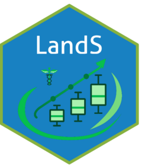

<!-- README.md is generated from README.Rmd. Please edit that file -->

# LandS <a href="https://stheberga.github.io/LandS/"></a>

LandS is an R package designed to make everyday biomarker, clinical, and
survival analysis workflows easier to run, easier to interpret, and
easier to reuse.

The package brings together a set of focused, task-oriented functions
for descriptive statistics, exploratory analyses, correlation work,
survival modelling, longitudinal plotting, publication-ready reporting,
and translational proteomics workflows. Rather than requiring numerous
disconnected scripts, LandS provides a more usable, function-based
interface for reproducible analysis.

## Why LandS is useful

LandS is built around usability and practical analysis workflows:

- simple and consistent function naming
- direct compatibility with common R data structures
- outputs that are ready for reporting and downstream analysis
- support for clinical, biomarker, and survival data workflows
- a compact API for iterative exploratory work and reproducible
  pipelines

The goal is to reduce friction in the analytical process while keeping
the package flexible enough for real-world study work.

## Package usability

This package is structured to feel approachable for both routine
analysis and more advanced study reporting. The functions are designed
around a clear idea: each function addresses a common analysis task
without forcing the user to assemble a large amount of custom code.

Most workflows in LandS follow a simple pattern:

1.  import the data
2.  prepare the variables
3.  run a focused function for the analysis
4.  inspect the summary or plot
5.  move the output into a report or manuscript

This makes the package useful for day-to-day analysis, exploratory work,
and structured reporting pipelines.

## Core functions

LandS exposes a broad set of functions, each aimed at a specific part of
the analysis workflow.

### Descriptive and exploratory analysis

- `descriptive_stats()` — generate concise descriptive statistics for
  numerical and grouped data
- `summary_by_group()` — create grouped summaries for comparing cohorts
  or subgroups
- `summarise_numeric_vars_by_group()` — summarise continuous variables
  across groups
- `correlations()` — compute and inspect correlations across variables
- `cont_var_test()` — perform continuous-variable statistical testing

### Survival and time-to-event analysis

- `fit_cox_model()` — fit Cox proportional hazards models
- `univariate_cox()` — perform univariate Cox analyses
- `multivariate_cox()` — fit multivariable Cox models
- `plot_km_curve()` — generate Kaplan-Meier survival curves

### Plotting and reporting

- `Boxplot()` — create publication-ready boxplots
- `Lineplots()` — generate longitudinal or trajectory plots
- `print_plot_grid()` — arrange plot panels for reporting
- `Printable()` — support structured printing and formatting workflows
- `Distribution()` — explore distributional patterns visually
- `Outlier_Report()` — flag and summarise outlier behaviour

### Formatting and utilities

- `build_filename()` — construct consistent output filenames
- `conv_to_string()` — convert values to strings for reporting
- `format_sys_time()` — format timestamps for reproducible outputs
- `formatz_p()` — format p-values in readable reporting style
- `Flex_format()` — create flexible formatted output structures
- `Npsurv_format()` — format survival outputs for presentation
- `Progress_bar()` — support progress reporting in long-running
  workflows

### Translational and proteomics support

- `olink_gsea_map()` — prepare Olink or pathway-oriented outputs
- `prot2gene()` — map protein identifiers to genes
- `similarity_kinetic()` — compare kinetic similarity patterns

## Installation

You can install the development version of LandS from GitHub:

``` r
# install.packages("pak")
pak::pak("StheBerga/LandS")
```

## Quick start

``` r
library(LandS)

# descriptive statistics
summary_table <- descriptive_stats(data = my_data, vars = c("age", "bmi", "score"))

# grouped summaries
by_group <- summary_by_group(data = my_data, group = "cohort", vars = c("age", "score"))

# survival analysis
cox_model <- univariate_cox(
  data = my_data,
  outcome = "time_to_event",
  event = "event_status",
  covariates = c("age", "sex", "group")
)

# Kaplan-Meier curve
km_plot <- plot_km_curve(
  data = my_data,
  time = "time_to_event",
  status = "event_status",
  group = "group"
)
```

## Typical workflow

A typical LandS workflow might look like this:

``` r
library(LandS)

# 1. descriptive exploration
stats <- descriptive_stats(my_data, vars = c("age", "bmi", "protein_x"))

# 2. compare groups
group_summary <- summary_by_group(my_data, group = "cohort", vars = c("age", "bmi"))

# 3. explore associations
corr <- correlations(my_data, vars = c("protein_x", "protein_y", "age"))

# 4. survival analysis
surv_model <- fit_cox_model(
  data = my_data,
  formula = survival::Surv(time_to_event, event_status) ~ age + cohort
)

# 5. visualise and report
km_plot <- plot_km_curve(my_data, time = "time_to_event", status = "event_status", group = "cohort")
```

## A package designed for practical analysis

LandS is intended to support the way analysts actually work: quickly,
iteratively, and with a strong emphasis on interpretable outputs. The
package is especially useful when working with:

- clinical and longitudinal datasets
- biomarker or proteomics measurements
- time-to-event analyses
- group comparisons and exploratory summaries
- presentation-ready figures and structured reporting

The API is intentionally composable, making it easy to combine functions
into reproducible analysis scripts and reports.

## Contributing

Contributions are welcome. If you are improving the package, consider
enhancing function usability, adding clearer examples, extending
validation workflows, or making outputs more reproducible and easier to
interpret.

## License

This project is licensed under the terms of the repository license.
